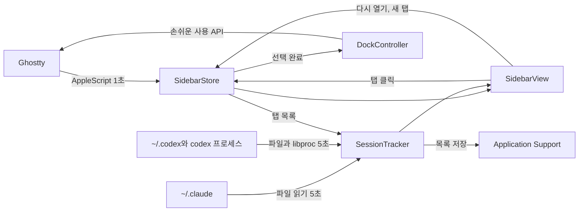

# 구조와 설계 결정

## 모듈

| 타깃 | 종류 | 역할 |
|---|---|---|
| `GhosttyBridge` | 라이브러리 | Ghostty 연결, 제목 해석, 창 배치 계산, Claude와 Codex 세션 파일 읽기. UI가 없어 단위 테스트 대상이다. |
| `GhosttySidebar` | 실행 파일 | SwiftUI 사이드바, 메뉴 막대 아이콘, 창 이동, 세션 추적 |
| `GhosttyProbe` | 실행 파일 | 터미널에서 연결 상태를 확인하는 도구 |
| `GhosttyBridgeTests` | 테스트 | 해석기, 배치 계산, 세션 매칭, 비용 계산, 프로젝트 묶기 테스트 76개 |

### GhosttyBridge

| 파일 | 역할 |
|---|---|
| `Models.swift` | 공유 계약. 탭, 창, 상태, 오류, `GhosttyControlling` 프로토콜 |
| `AppleScriptGhosttyBridge.swift` | 스냅숏, 탭 선택, 새 탭 열기. AppleScript 하나를 한 번 컴파일해 재사용한다. |
| `TitleParser.swift`, `SnapshotParser.swift` | 탭 제목에서 상태를 판정하고, 스냅숏 문자열을 모델로 바꾼다. |
| `ArrangePlanner.swift`, `GhosttyWindowArranger.swift` | 사이드바와 겹치는 창을 오른쪽으로 민다. System Events를 쓴다. |
| `SnapPlanner.swift`, `GhosttyWindowSnapper.swift` | 선택한 탭의 창을 사이드바 오른쪽에 붙인다. 손쉬운 사용 API를 쓴다. |
| `PanelLayout.swift` | 사이드바의 위치와 크기를 화면 안으로 맞춘다. |
| `ProjectGrouping.swift` | 작업 폴더에서 프로젝트 폴더를 찾고 항목을 프로젝트별로 묶는다. 창 순서를 고정하는 `StableOrder`도 있다. |
| `Sessions/ClaudeSessions.swift` | 실행 중인 Claude 세션과 대화 기록 파일 위치 |
| `Sessions/CodexSessions.swift` | 실행 중인 Codex 프로세스와 rollout 파일의 짝 맞추기 |
| `Sessions/TranscriptScanner.swift` | 대화 기록을 이어 읽으며 비용, 제목, 브랜치를 모은다. |
| `Sessions/Pricing.swift` | 모델별 API 가격과 비용 계산 |
| `Sessions/SessionMatcher.swift` | 탭과 Claude 세션의 짝 맞추기 |
| `Sessions/SessionSnapshot.swift` | 열린 세션 목록의 형식과 저장 |
| `Sessions/ClosedSessions.swift` | 직접 닫은 세션 목록의 형식, 보관 규칙 |
| `Sessions/SessionListPaths.swift` | 사이드바 전용 저장 폴더의 경로 |

### GhosttySidebar

| 파일 | 역할 |
|---|---|
| `AppDelegate.swift` | 패널을 만들고 각 구성 요소를 연결한다. |
| `SidebarStore.swift` | 1초마다 Ghostty 스냅숏을 읽는다. 탭 선택과 새 탭 열기를 처리한다. |
| `DockController.swift` | 모니터, 위치, 크기, 창 정렬과 붙이기, 손쉬운 사용 권한 |
| `AutoHider.swift` | Dock 방식의 자동 숨기기 |
| `SessionTracker.swift` | 세션 추적, 비용, 목록 저장, 닫힌 세션, 다시 열기 |
| `SidebarView.swift` | 화면 전체 |
| `StatusMenu.swift` | 메뉴 막대 아이콘의 메뉴 |
| `Theme.swift` | Catppuccin Mocha 색과 글꼴 |
| `MockGhosttyBridge.swift` | `--mock` 실행용 가짜 데이터 |

## 데이터 흐름

- AppleScript 호출은 직렬 큐 하나에서만 실행한다. `NSAppleScript`는 스레드 안전하지 않고, 스냅숏과 탭 선택이 Ghostty 안에서 겹치면 안 되기 때문이다.
- 세션 파일 읽기는 백그라운드 작업에서 한다. 화면 갱신은 메인 액터에서만 한다.

## 주요 결정

### Ghostty를 고치지 않고 옆에 붙인다

Ghostty를 포크하면 업스트림 변경을 계속 따라가야 한다. Ghostty 1.3.1은 AppleScript 사전을 제공한다.
창, 탭, 터미널의 id와 제목과 작업 폴더를 읽을 수 있고, 탭 선택과 새 탭 열기도 할 수 있다.
그래서 기본 Ghostty를 그대로 쓰고 사이드바만 따로 만들었다.

AppleScript로는 창 위치를 바꿀 수 없다. 창 이동은 System Events와 손쉬운 사용 API로 한다.

### 창 정렬은 System Events, 창 붙이기는 손쉬운 사용 API

- 정렬은 모든 창의 위치를 한 번에 읽고 옮겨야 한다. System Events 스크립트 하나로 처리한다.
- 붙이기는 방금 선택한 창 하나를 빠르게 옮겨야 하고, 그 창을 기억했다가 사이드바 크기가 바뀔 때마다 다시 옮긴다. 앱 안에서 손쉬운 사용 API로 창 객체를 잡아 두는 편이 빠르다.
- 다른 모니터로 옮길 때 이전 모니터 크기로 잘리는 경우가 있다. 그래서 크기, 위치, 크기 순서로 두 번 적용한다.

### 손쉬운 사용 권한과 서명

macOS는 손쉬운 사용 권한을 앱 서명에 묶는다. 임시 서명은 빌드마다 바뀌어 권한이 조용히 풀린다.
빌드 스크립트는 Apple Development 인증서로 서명하고, 권한이 없으면 사이드바가 안내 상자를 띄운다.

### 상태 판정은 탭 제목으로

Claude Code는 터미널 제목 맨 앞에 상태 기호를 넣는다. Ghostty는 탭의 프로세스 정보를 주지 않으므로 제목이 유일한 단서다.
Codex는 작업 중일 때 회전 기호를 넣는 것으로 보인다. 대기 상태 기호는 아직 확인하지 않았다.

### 탭과 세션은 제목으로 짝을 맞춘다

Claude Code는 터미널 제목을 대화 기록의 AI 제목과 같게 설정한다. 그래서 다음 순서로 짝을 맞춘다.

1. 같은 제목이고 작업 폴더도 같은 세션
2. 같은 제목인 세션
3. 제목이 12자 이상이고 앞부분이 같은 세션. Ghostty가 긴 제목을 자르는 경우에 대비한다.

세션 하나는 탭 하나에만 연결한다.

### Codex 세션은 프로세스와 기록 파일로 찾는다

Codex는 Claude의 `sessions/<PID>.json` 같은 파일이 없고, 실행 인자도 감춘다. 그래서 다음 순서로 찾는다.

1. libproc으로 `codex` 프로세스를 찾는다. 터미널이 없는 프로세스(`app-server`, IDE 도우미)는 뺀다.
2. 프로세스의 작업 폴더와 시작 시각을 읽는다.
3. 직전 확인에서 이미 짝이 맞았던 프로세스는 그 세션을 그대로 유지한다.
4. 사이드바가 `codex resume`으로 연 세션은 사이드바가 남긴 단서(폴더, 시각, ID)로 고른다. 단서는 12시간 동안 유지한다.
5. 새 세션: rollout 파일은 같은 폴더에서 그 파일이 만들어지기 직전에 시작한 프로세스에 붙인다. 파일 이름에 시작 시각과 세션 ID가 있다.
6. 그 밖의 경우, 같은 폴더에서 프로세스 시작 뒤에 수정된 파일 가운데 가장 최근 것을 고른다.

3, 5, 6번은 추정이므로 두 가지 조건을 더 건다.

| 조건 | 이유 |
|---|---|
| `~/.codex/thread-writer-locks/<ID>.lock`이 있어야 한다. | Codex는 열린 세션마다 잠금 파일을 두고 종료할 때 지운다. 사이드바를 다시 시작해도 이 파일로 판단할 수 있다. |
| 끝난 것으로 본 세션은 그 뒤에 기록 파일이 다시 써져야 한다. | 같은 폴더에 Codex가 둘 있을 때, 한쪽 탭을 닫으면 그 세션이 다른 프로세스로 넘어가는 일을 막는다. |

서브에이전트의 rollout 파일은 `source`가 객체이므로 뺀다.

### 대화 저장은 Claude와 Codex, 목록 관리는 사이드바

| 대상 | 저장 주체 |
|---|---|
| 대화 내용 | Claude Code와 Codex. 사이드바는 읽기만 한다. |
| 열려 있던 세션 목록 | 사이드바 |
| 직접 닫은 세션 목록 | 사이드바 |

Claude와 Codex는 대화는 저장하지만, 재부팅 직전에 어떤 세션이 열려 있었는지는 남기지 않는다. 그래서 그 목록만 사이드바가 맡는다.
사이드바는 `~/.claude`와 `~/.codex`에 아무것도 쓰지 않는다.

### 직접 닫음과 비정상 종료의 구분

| 상황 | 판정 | 처리 |
|---|---|---|
| 5초 사이에 세션 하나가 끝남 | 직접 닫음 | 열린 세션 목록에서 빼고 "최근에 닫음"에 넣는다. |
| 5초 사이에 세션 두 개 이상이 끝남 | 비정상 종료 | 열린 세션 목록에 남기고 "비정상 종료"에 보여 준다. |
| 사이드바가 시작할 때 목록에 있지만 실행 중이 아닌 세션 | 비정상 종료 | 사이드바가 꺼져 있던 동안 끝난 세션이다. 다만 "최근에 닫음" 기록이 있으면 직접 닫은 것으로 본다. |

열린 세션 목록은 그 종류의 세션이 0개가 되어도 다시 쓴다. 처음에는 0개일 때 쓰지 않았다. 그러자 마지막 Codex 창을 직접 닫아도 그 세션이 `codex.json`에 남았고, 사이드바를 다시 시작하면 비정상 종료로 나왔다. Codex는 보통 하나만 띄우므로 닫은 Codex 세션이 거의 모두 이렇게 보였다.

창 하나에 탭이 두 개 있을 때 창을 닫으면 비정상 종료로 분류된다. 이 경우는 사용자가 항목을 지우면 된다.

### 프로젝트는 git 저장소의 최상위 폴더로 정한다

- 프로젝트별 보기는 작업 폴더에서 위로 올라가며 `.git`이 있는 폴더를 찾는다. `.git`이 파일인 연결 worktree도 자기 폴더를 프로젝트로 본다.
- 홈 폴더 자체는 프로젝트 폴더로 보지 않는다. 홈 폴더가 dotfiles 저장소이면 모든 탭이 한 묶음이 되기 때문이다.
- 홈 폴더 밖의 경로는 디스크를 확인하지 않고 그 폴더를 그대로 프로젝트로 본다. 폴더 확인은 화면을 그릴 때 메인 스레드에서 하므로, 잠든 네트워크 드라이브를 건드리면 화면이 멈춘다.
- 결과는 경로마다 60초 동안 캐시한다. 그래서 나중에 `git init`을 한 폴더도 1분 안에 반영된다.
- 프로젝트 순서는 그 프로젝트의 첫 탭 순서를 따른다. 창은 처음 나타난 순서로 고정한다. Ghostty의 창 순서를 그대로 쓰면, 탭을 클릭해 창이 앞으로 올 때마다 목록이 움직인다.
- 심볼릭 링크와 대소문자는 풀지 않는다. `/tmp`와 `/private/tmp`는 서로 다른 프로젝트가 된다.

### 비용 계산

- Claude Code 대화 기록의 `message.usage`에 API 정가를 곱한다. 구독 사용자에게는 실제 청구액이 아니라 API 환산 금액이다.
- 응답 하나가 블록마다 같은 사용량으로 여러 줄 기록된다. `message.id`로 한 번만 센다.
- 캐시 쓰기는 5분 TTL이 입력 단가의 1.25배, 1시간 TTL이 2배다. fast 모드 응답은 2배로 센다.
- 가격은 2026-11-03 기준 Claude API 정가다. 모르는 모델은 0으로 센다.
- 대화 기록은 이어 읽는다. 파일마다 읽은 위치를 기억하고, 새로 붙은 부분만 1MB씩 읽는다.

### 성능 원칙

| 작업 | 주기 |
|---|---|
| Ghostty 스냅숏 | 1초. 이전 스냅숏이 끝나지 않았으면 건너뛴다. |
| 세션 확인과 비용 | 5초 |
| 오늘 비용 합계 | 30초. 모든 프로젝트 폴더를 훑는 일은 5분에 한 번 |
| Codex 기록 파일 짝 맞추기 | 프로세스가 바뀌거나 1분이 지났을 때 |
| 닫힌 세션의 기록 파일 확인 | 1시간 |
| 자동 숨기기 마우스 확인 | 0.1초. 자동 숨기기를 켰을 때만 |

평소 CPU는 1% 안팎, 메모리는 70MB대다.

## 저장 파일

### 사이드바 전용 폴더

`~/Library/Application Support/Ghostty Sidebar/sessions/`

| 파일 | 내용 |
|---|---|
| `claude.json` | 열려 있어야 할 Claude 세션의 ID, 폴더, 제목, 브랜치 |
| `codex.json` | 열려 있어야 할 Codex 세션의 ID, 폴더, 제목 |
| `closed.json` | 직접 닫은 세션과 닫은 시각. 7일, 30개까지 |
| `history/claude/`, `history/codex/` | 이전 목록의 사본. 10분에 한 번, 종류별 10개까지 |

목록 형식은 예전 `cc-session` 스크립트와 같다. 처음 실행할 때 예전 위치(`~/.claude/session-restore/`, `~/.codex/session-restore/`)의 목록을 한 번 옮겨 온다.

### 설정 (UserDefaults)

설치한 앱은 `dev.local.ghostty-sidebar` 영역을, 디버그 실행 파일은 `ghostty-sidebar` 영역을 쓴다.

| 키 | 기본값 | 의미 |
|---|---|---|
| `dockScreenName` | 주 모니터 | 사이드바를 둘 모니터 |
| `panelWidth`, `panelHeight` | 260, 전체 높이 | 사이드바 크기 |
| `panelOffsetX`, `panelOffsetTop` | 0, 0 | 화면 왼쪽 위로부터의 위치 |
| `autoArrangeGhostty` | 켜짐 | 겹치는 창을 옆으로 밀기 |
| `snapGhosttyOnSelect` | 켜짐 | 탭 클릭 시 창 붙이기 |
| `snapFillWidth` | 켜짐 | 붙일 때 남은 너비 채우기 |
| `autoHideSidebar` | 꺼짐 | 자동 숨기기 |
| `animateBusySpinner` | 켜짐 | 작업 중 회전 표시 |
| `showSessionCost` | 켜짐 | 비용 표시 |
| `autoSaveSessions` | 켜짐 | 세션 목록 자동 저장 |
| `closedSessionsExpanded` | 꺼짐 | 닫힌 세션 그룹 펼침 |
| `groupByProject` | 꺼짐 | 프로젝트별로 묶기 |
| `dismissedRestoreSessions` | 없음 | 비정상 종료 목록에서 지운 세션 ID |

## 권한

| 권한 | 용도 |
|---|---|
| 자동화: Ghostty | 탭 목록 읽기, 탭 선택, 새 탭 열기 |
| 자동화: System Events | 창 정렬 |
| 손쉬운 사용 | 창 붙이기와 정렬 |

## 한계

- 사이드바가 실행 중일 때 닫힌 세션만 "최근에 닫음"에 기록한다.
- 질문을 한 번도 하지 않은 Codex 세션은 기록 파일이 없어 목록에 넣지 않는다.
- Codex 세션의 비용은 표시하지 않는다.
- Haiku 5.5의 10만 토큰 초과 요금은 따로 계산하지 않는다.
- 탭 이름을 바꾸면 상태 판정과 탭 연결이 끊긴다. 탭 이름 바꾸기 기능은 보류했다.
